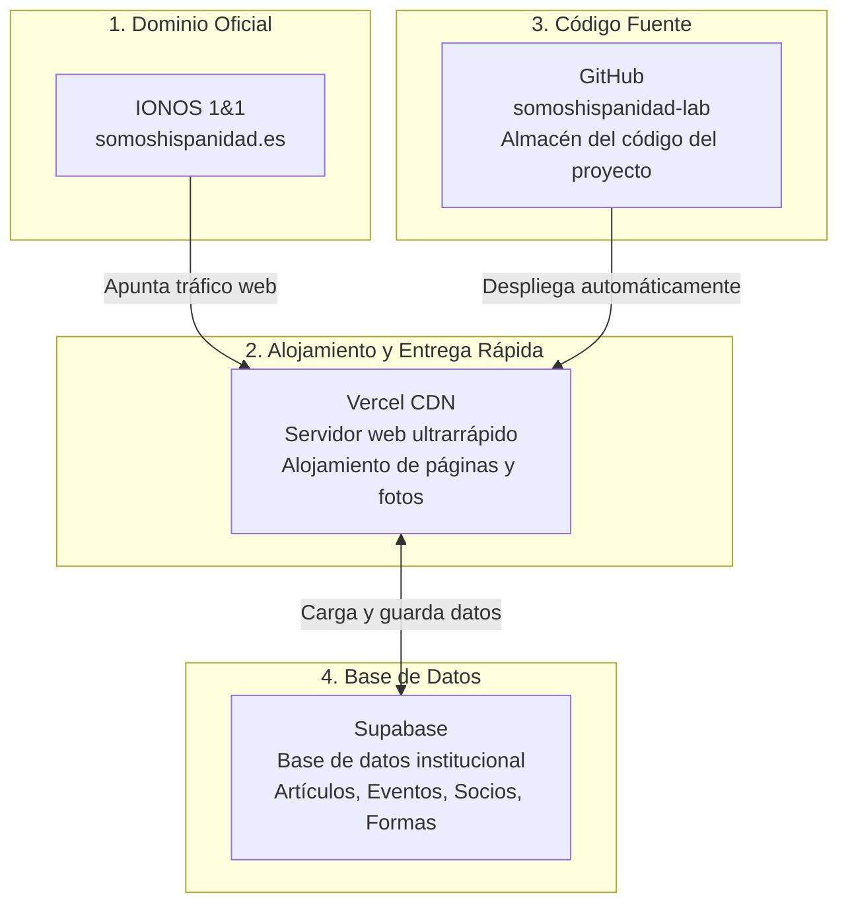

# 📘 Guía del Propietario — Arquitectura y Gestión de Somos Hispanidad

> **Documento Oficial de Traspaso y Operaciones**  
> *Destinado a la Presidencia, Secretaría o a cualquier persona a la que se delegue la titularidad y administración tecnológica de la Asociación Cultural Somos Hispanidad.*  
> *Redactado en lenguaje claro, visual y sin tecnicismos innecesarios (apto para no programadores).*

---

## 🏛️ 1. La Arquitectura en un Vistazo (Las 4 Piezas Clave)

La web de Somos Hispanidad (`www.somoshispanidad.es`) funciona con una arquitectura moderna, segura, de alto rendimiento y **a coste cero (100% en planes gratuitos para entidades sin ánimo de lucro)**.

Se compone de cuatro pilares interconectados:

### ¿Qué hace cada plataforma?

| Componente | Servicio | Misión en la Asociación | Cuenta Titular |
|---|---|---|---|
| **Dominio y DNS** | **IONOS** | Registrador del nombre `somoshispanidad.es` y gestión de registros DNS. | `somoshispanidad@gmail.com` |
| **Alojamiento (Web + CDN)** | **Vercel** | Publica la web globalmente, gestiona el certificado de seguridad SSL (candado verde) y entrega las imágenes a máxima velocidad. | `somoshispanidad@gmail.com` |
| **Repositorio (Código)** | **GitHub** | Guarda el historial del código, archivos HTML, hojas de estilo CSS y scripts de automatización. | Organización `somoshispanidad-lab` |
| **Base de Datos y Usuarios** | **Supabase** | Guarda los contenidos dinámicos: artículos de autores, próximos actos, inscripciones a eventos y socios simpatizantes. | `somoshispanidad@gmail.com` |

---

## 🔑 2. Cuentas y Accesos Centralizados

Todas las plataformas han sido unificadas bajo el correo institucional único de la asociación, eliminando cualquier dependencia de correos personales o de desarrolladores externos:

* **Correo Propietario Único**: `somoshispanidad@gmail.com`
* **Organización en GitHub**: [`github.com/somoshispanidad-lab`](https://github.com/somoshispanidad-lab)
* **Panel Vercel**: [`vercel.com/somos-hispanidad-s-projects`](https://vercel.com/somos-hispanidad-s-projects)
* **Panel Supabase**: [`supabase.com/dashboard/project/fzftntxrkagnvchhwehn`](https://supabase.com/dashboard/project/fzftntxrkagnvchhwehn)

---

## 🚀 3. Cómo Publicar Cambios en la Web (En 1 Clic)

No hace falta escribir comandos complejos en la terminal ni saber programar para publicar una actualización de la web.

### Pasos para publicar:
1. Abre la carpeta del proyecto en tu Mac: `SOMOS AG-GH-VL`.
2. Haz **doble clic** sobre el archivo ejecutable:
   👉 **`PUBLICAR.command`**
3. Se abrirá una ventana que te preguntará: `¿Publicar ahora? (s/n):`.
4. Escribe `s` y pulsa `Enter`.
5. El sistema automáticamente:
   - Guarda los cambios realizados en el ordenador.
   - Los sube a GitHub con la firma institucional de Somos Hispanidad.
   - Activa el despliegue automático en Vercel.
   - Te confirma: `🎉 ¡PUBLICACIÓN COMPLETADA! — www.somoshispanidad.es`.

---

## ✍️ 4. Gestión Diaria de Contenidos: El Panel de Administración

Para redactar nuevos artículos, convocar actos o revisar socios no necesitas tocar código:

1. Entra desde tu navegador en:
   👉 **[www.somoshispanidad.es/admin](https://www.somoshispanidad.es/admin)**
2. Inicia sesión con tus credenciales de administrador (gestor de contenidos de Somos Hispanidad).
3. Desde este panel visual puedes:
   * **Contenidos y Artículos**: Crear, editar o despublicar artículos, asociándolos a autores.
   * **Actos Culturales y Eventos**: Publicar conferencias, visitas culturales y salidas guiadas (indicando fecha, lugar y aforo).
   * **Inscripciones**: Ver la lista de personas que se han apuntado a cada acto.
   * **Socios y Simpatizantes**: Consultar altas de colaboradores de la asociación.
   * **Mensajes de Contacto**: Leer las consultas enviadas a través del formulario de la web.

---

## ⚠️ 5. Regla de Oro para Imágenes (Lección Aprendida del Escorial)

### ¿Qué ocurrió en el incidente del Escorial?
En junio de 2026 se subieron a Supabase Storage 24 fotos tomadas directamente de teléfonos móviles en altísima resolución (varios megabytes cada una). Al abrir la galería, cada visitante descargaba decenas de megabytes directamente de la base de datos, lo que agotó la cuota mensual de ancho de banda gratuito de Supabase (5 GB) y bloqueó temporalmente el servicio.

### La Solución Definitiva Implantada:
* **Separación de responsabilidades**: 
  - **Supabase** solo debe alojar textos ligeros y datos numéricos (su cuota para texto es prácticamente infinita).
  - **Vercel** aloja las fotos, gráficos y documentos estáticos, porque su red de distribución (CDN) ofrece **100 GB gratuitos al mes** (20 veces más).
* **Guía rápida para añadir fotos en el futuro**:
  1. Antes de publicar una foto, redúcela de peso (máximo 200–300 KB por imagen, formato JPG o WebP a 1200px de ancho).
  2. Si es una galería de fotos fija de un evento (como la del Escorial), colócala en `assets/images/` y publícala con `PUBLICAR.command`.

---

## 💡 6. Dictamen Técnico: ¿Por qué NO migrar a Firebase?

Durante la resolución del problema se evaluó migrar la base de datos a Google Firebase. Se desaconseja de forma definitiva por los siguientes motivos:

1. **Incompatibilidad de modelo**: Supabase utiliza PostgreSQL (base de datos relacional con tablas y relaciones entre autores, eventos y artículos). Firebase Firestore es NoSQL (árboles de documentos), lo que obligaría a reescribir todo el código del sitio web y del panel de control.
2. **Límites similares**: Firebase Spark (gratuito) también tiene límites de lecturas diarias y transferencias. Si se hubiesen subido las fotos sin optimizar a Firebase Storage, el problema habría sido idéntico.
3. **Solución óptima ya activa**: Con las fotos servidas desde el CDN de Vercel y los textos en Supabase, la arquitectura actual es **ultrarrápida, gratuita, fiable y totalmente estable**.

---

## 📋 7. Protocolo de Traspaso / Relevo de la Titularidad

Si en el futuro la presidencia o la secretaría de la Asociación cambia y debes delegar este rol:

1. **Traspaso del Correo**:
   - Entregar el acceso y credenciales de `somoshispanidad@gmail.com`.
2. **Verificación de Plataformas**:
   - Comprobar que el nuevo responsable puede entrar a:
     - GitHub (`somoshispanidad-lab`)
     - Vercel (`somos-hispanidad-s-projects`)
     - Supabase (`fzftntxrkagnvchhwehn`)
     - Panel de IONOS (gestión del dominio `somoshispanidad.es`)
3. **Instalación en un nuevo ordenador (si fuera necesario)**:
   - Clonar el repositorio: `git clone https://github.com/somoshispanidad-lab/somos-hispanidad-web.git`
   - Copiar el archivo local privado `.vercel-config` con las claves institucionales.
   - ¡Listo! Podrá seguir publicando con `PUBLICAR.command`.

---

*Documento revisado y validado en octubre de 2026.*  
*Asociación Cultural Somos Hispanidad — Por la difusión de la verdad histórica y la cultura hispánica.*
